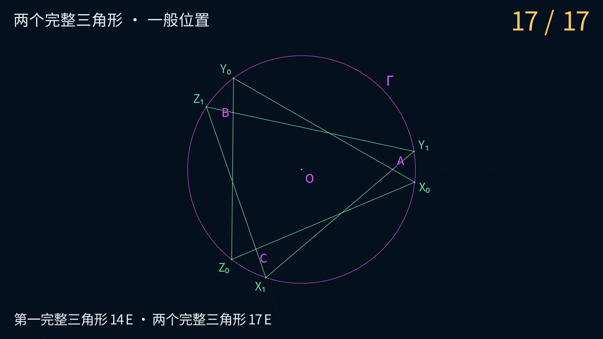

# Euclid-Castillon-Min · Inscribed-Triangle Constructions

[简体中文](README.md) · **English**

**Draw one solution triangle with 14 lines, or both solution triangles with 17 lines. No additional circles are drawn.**

Given a circle, its center, and three points, construct an inscribed triangle whose side
lines respectively pass through those points. This project provides step-by-step animations, elementary traces,
general-parameter proofs, independent exact verification, solution classification, and bounded searches.
**14 and 17 E are verified generic upper bounds. Global minimality and full-domain robust bounds remain open.**

[Watch the 17 E two-solution animation](animations/castillon/media/CastillonBoth_4k60.mp4) ·
[14 E single-solution animation](animations/castillon/media/CastillonOne_4k60.mp4) ·
[Construction and proof](docs/CONSTRUCTION.md) · [Exact verification](experiments/results/sage-verification.json)

[](animations/castillon/media/CastillonBoth_4k60.mp4)

*Click the preview to view or download the two-solution animation, 3840 × 2160, 60 fps, approximately 67 seconds.*

## Explore the constructions

| Animation | Target | Duration | Video |
|---|---|---:|---|
| One solution in 14 E | One complete triangle, using 14 lines | About 58 seconds | [4K60 MP4](animations/castillon/media/CastillonOne_4k60.mp4) |
| Both solutions in 17 E | Two complete triangles, using 17 lines | About 67 seconds | [4K60 MP4](animations/castillon/media/CastillonBoth_4k60.mp4) |

The videos use a dark blue background, Chinese captions, and thin lines. Magenta denotes free inputs,
gold the current move, pale blue auxiliary objects, and green the targets. Each draw highlights
its two existing reference points and shows the cumulative E count. The visual style follows
[Euclid-CCC-Min](https://github.com/lenovobenben/euclid-ccc-min).

Geometry is exported from exact replay and checked against the committed certificate. The videos use
the `inside` fixture, with all three given points inside the circle. The fixed-point axis is drawn
at move 11, followed by the triangle sides. Each video starts from the free inputs, sharing the
first 14 moves. All vertices appear at move 16 in the two-solution video. The independent 15 E
vertex-only program omits the final side of the first triangle.

See the [animation guide](animations/castillon/README.md) for geometry export, viewport tests,
and rendering commands. Detailed mathematical documents are currently in Chinese.

## Current verified upper bounds

| Target | Lines | New circles | Generic `gen` | Full-domain `rob` |
|---|---:|---:|---:|---|
| Three vertices of one solution `one_vertices` | 13 | 0 | **13 E** | Not established |
| One complete triangle `one_edges` | 14 | 0 | **14 E** | Not established |
| All vertices of both solutions `all_vertices` | 15 | 0 | **15 E** | Not established |
| Both complete triangles `all_edges` | 17 | 0 | **17 E** | Not established |

The common prefix draws the fixed-point axis at move 11, obtaining one starting vertex
of each solution. The given circle remains available for intersections. Each row is a
separately trimmed program; 15 E is not the first-hit time of the 17 E full program.

`gen` requires a relatively open, dense, full-measure subset of the study domain D₂.
`rob` covers the entire domain with worst-case actual drawing cost. Exceptional auxiliary
coincidences and parallel defining lines have not yet all been repaired.

### Restricted improvement with a proper AB secant

When AB intersects Γ in two distinct real points, another generic construction gives these bounds.

| Target | Restricted upper bound |
|---|---:|
| Three vertices of one solution | **11 E** |
| One complete triangle | **12 E** |
| All vertices of both solutions | **13 E** |
| Both complete triangles | **15 E** |

This includes generic two-solution inputs with all three given points inside the circle.
Starting with AB makes two projection involutions exchange the same pair of circle points.
Using the inverse map, five moves yield three image pairs, and move 9 draws the fixed-point axis.
See the [secant construction](docs/SECANT.md) for six-parameter identities, 20 independent exact
replays, and a two-solution input outside the secant domain.

### Free inputs and the two-solution domain

Only Γ, its center O, and distinct noncollinear points A, B, C off Γ are free.
No circumference point, radius endpoint, coordinate axis, or line is free. Side extensions are allowed.
For radius R, area S of ABC, and point powers p_P=OP²−R², define

$$
K=4R^2S^2+p_Ap_Bp_C.
$$

Let e count tangent contact points from each given point lying on the line through the other two.
The two-nondegenerate-solution domain D₂ is exactly **K>0 and e=0**.
[CLASSIFICATION](docs/CLASSIFICATION.md) also covers zero, one, and infinitely many solutions.
Input solvability and applicability of a particular auxiliary construction are separate questions.

## What counts as an E move

| Operation | Cost |
|---|---:|
| Draw a complete line through two existing distinct points | 1 E |
| Draw a circle centered at an existing point through another existing point | 1 E |
| Obtain or name a determined finite real intersection | 0 E |
| Given circle, center, and three input points | 0 E |
| Execute the same draw again | Still 1 E |

Use an unmarked straightedge and a **collapsing compass**. Arbitrary auxiliary points,
points at infinity, and free distance transfer are forbidden. All finite real intersections
of each new object with existing distinct objects enter the point set automatically.
Composite operations must be expanded. Draws used for branch tests, failed attempts,
and duplicate draws count; referencing an existing object does not add E.

The elementary semantics follow Euclid-Min's fixed-version [metrics](https://github.com/lenovobenben/euclid-min/blob/792619b38d749643bc9d80da8110dc9cff5b4877/docs/METRICS.md) and
[formal model](https://github.com/lenovobenben/euclid-min/blob/792619b38d749643bc9d80da8110dc9cff5b4877/docs/FORMAL_MODEL.md). This project's inputs, targets, and coverage are defined in
[DESIGN](docs/DESIGN.md). Scores for different problems are not directly comparable.

## Sources and project contribution

The geometric route uses the classical fixed-point axis of a circle projectivity, described
in Maurice Starck's [*Castillon’s problem*](https://www.polyhedra-world.nc/stuff/Castillon.pdf), 2002.
This project supplies a deterministic center chord, shared projection chords, the 11 E prefix,
13/14/15/17 E traces, exact replays, general identities, and search records.
It claims no historical priority for the method or counts. See [LITERATURE](docs/LITERATURE.md).

## Exact verification

| Check | Result or purpose | Record |
|---|---|---|
| Standard-library replay | Four fixtures, five programs, no duplicate draws | [Certificates](experiments/results/baseline.json) |
| Independent Sage replay | 20 programs, closure, recounts, first-hit times; four invalid controls rejected | [Report](experiments/results/sage-verification.json) |
| General identities | Five-parameter point pairs, fixed-point axis, and generic nondegeneracy | [Script](experiments/verify_sage.py) |
| Classification | Six-parameter identities, 21 exact examples, four baseline-domain checks | [Report](experiments/results/classification-verification.json) |

The constructor uses Fraction and a real quadratic field. The independent Sage verifier
imports none of that geometry code and recounts the score. Claimed coordinates may only
select independently computed intersections. Finite examples, general proofs, coverage,
and minimality are separate evidence. Exact decisions use no tolerance; python -O is unsupported.

## Reproduction

Python 3.10+ standard library runs the geometry, search, and animation-data regression checks:

```sh
python3 -m unittest discover -v
```

The standard-library environment runs twelve checks. The Manim environment runs three additional
checks for viewports, line clipping, and numerical-search calibration. Regenerate the animation
geometry with the following command.
The [animation guide](animations/castillon/README.md) includes 4K60 rendering instructions.

```sh
python3 animations/castillon/export_geometry.py
```

Independent SageMath 10.7 verification uses a pinned image, no network, and a read-only mount:

```sh
docker run --rm --network none \
  -v "$PWD:/workspace:ro" -w /workspace \
  -e PYTHONDONTWRITEBYTECODE=1 \
  sagemath/sagemath@sha256:4f5589eb6c565949a006f8665de2876b8414410daf5ac554f4434a15d4f3d528 \
  sage -python experiments/verify_sage.py
```

With the image cached, neither network access nor a persistent container is needed.
See [complete reproduction instructions](docs/REPRODUCING.md) for classification, certificate
regeneration, bounded searches, and expected outputs.

## Current research directions

First seek a complete single triangle below 14 E, then improve shared two-solution programs,
mixed-circle prefixes, direct target hits, and robust repairs. Screening 9,878 restricted
prefixes is not a global lower bound. See [ROADMAP](docs/ROADMAP.md) and [SEARCH](docs/SEARCH.md).

## Documentation and code

| Content | Entry |
|---|---|
| Inputs, targets, and claim levels | [DESIGN](docs/DESIGN.md) |
| Elementary trace and proof | [CONSTRUCTION](docs/CONSTRUCTION.md) |
| Restricted 12/15 E construction with an AB secant | [SECANT](docs/SECANT.md) |
| Existence, counts, and degeneracy | [CLASSIFICATION](docs/CLASSIFICATION.md) |
| Full reproduction commands | [REPRODUCING](docs/REPRODUCING.md) |
| Bounded searches already performed | [SEARCH](docs/SEARCH.md) |
| Animations, geometry export, and rendering | [animations/castillon](animations/castillon/README.md) |
| Research roadmap and presentation conventions | [ROADMAP](docs/ROADMAP.md) |
| Sources and comparability | [LITERATURE](docs/LITERATURE.md) |
| Research scripts | [experiments](experiments/README.md) |
| Certificates and reports | [experiments/results](experiments/results/README.md) |
| Regression checks | [tests](tests/README.md) |
| Series conventions and four-project comparison | [SERIES](docs/SERIES.md) |

**Construction optimization series**:
[Euclid-Min](https://github.com/lenovobenben/euclid-min) ·
[Euclid-CCC-Min](https://github.com/lenovobenben/euclid-ccc-min) ·
[Euclid-Equal-Angle-Min](https://github.com/lenovobenben/euclid-equal-angle-min) ·
[Euclid-Castillon-Min](https://github.com/lenovobenben/euclid-castillon-min).


## License and citation

Code, tests, and configuration use [Apache 2.0](LICENSE). Mathematical documentation,
construction records, research data, and citation metadata use [CC BY 4.0](LICENSE-CONTENT).
Third-party rights are unchanged; see the [license scope](LICENSE-SCOPE.md).
Use [CITATION.cff](CITATION.cff), citing **lenovobenben, Euclid-Castillon-Min**, the
[repository](https://github.com/lenovobenben/euclid-castillon-min), and the commit or version used.
Indicate modifications when adapting non-software content.
