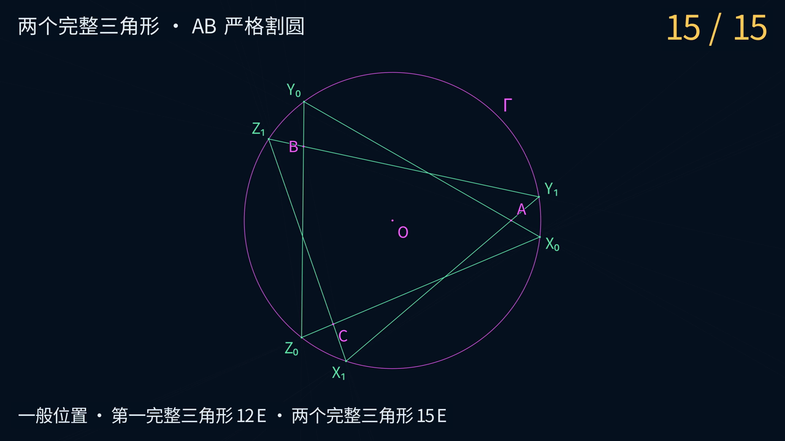

# Euclid-Castillon-Min · 圆内接三角形的尺规构造

**简体中文** · [English](README.en.md)

**AB 割圆的一般位置下，只画 12 条直线完成一个目标三角形，15 条直线完成两个目标三角形。**

给定圆、圆心和三个点，研究 Cramer–Castillon 问题：作圆内接三角形，使三边所在直线
分别经过给定点。本项目提供逐步动画、逐笔构造、一般参数证明、独立精确核验、解数分类及有界搜索。
**整个二解域的一般位置上界为 14、17 E，严格割线子域为 12、15 E。全局最小性与完整域鲁棒上界待研究。**

[观看 15 E 双解动画](animations/castillon/media/CastillonBoth_15E_4k60.mp4) ·
[12 E 单解动画](animations/castillon/media/CastillonOne_12E_4k60.mp4) ·
[割线构造与证明](docs/SECANT.md) · [精确核验](experiments/results/secant-seed-verification.json)

[](animations/castillon/media/CastillonBoth_15E_4k60.mp4)

*点击预览图查看或下载双解动画，3840 × 2160，60 fps，约 64 秒。单解动画约 55 秒。*

## 先看演示

| 动画 | 完成的目标 | 适用范围 | 成片 |
|---|---|---|---|
| 12 E 单解 | 一个完整三角形，12 条直线 | AB 严格割圆的一般位置 | [4K60 MP4](animations/castillon/media/CastillonOne_12E_4k60.mp4) |
| 15 E 双解 | 两个完整三角形，15 条直线 | AB 严格割圆的一般位置 | [4K60 MP4](animations/castillon/media/CastillonBoth_15E_4k60.mp4) |

动画采用深蓝背景、中文字幕和细线。洋红色表示免费输入，金色表示当前一笔，
淡蓝色表示辅助对象，绿色表示目标。每次落笔前标出两个已有定位点，并显示累计 E。
视觉风格参考 [Euclid-CCC-Min](https://github.com/lenovobenben/euclid-ccc-min)。

几何数据从精确重放导出，并逐项核对已提交证书。演示采用三个输入点均在圆内的
`inside` 夹具，首笔画 AB，复用正向与逆向投影，在第 9 E 画出不动点轴。
两段视频各自从免费输入开始，共用前 12 E。双解片的全部顶点在第 14 E 出现；
独立的 13 E 顶点程序省去第一解的补边动作。

导出、镜头测试和渲染命令见 [动画说明](animations/castillon/README.md)。

## 当前已验证上界

| 目标 | 直线 | 新增圆 | 一般位置 `gen` | 完整域 `rob` |
|---|---:|---:|---:|---|
| 一个解的三个顶点 `one_vertices` | 13 | 0 | **13 E** | 待研究 |
| 一个完整三角形 `one_edges` | 14 | 0 | **14 E** | 待研究 |
| 两个解的全部顶点 `all_vertices` | 15 | 0 | **15 E** | 待研究 |
| 两个完整三角形 `all_edges` | 17 | 0 | **17 E** | 待研究 |

公共前缀在第 11 E 画出不动点轴，得到两个解各自的起始顶点。
新增圆为零表示不额外画圆；免费输入圆仍参与求交。每行对应独立裁剪程序，
15 E 顶点程序的分数不是 17 E 完整程序中的首次命中时刻。

`gen` 要求覆盖研究域中相对开稠密、满测度的子域；`rob` 要求覆盖整个研究域，
按最坏实际成本计费。当前尚未补齐辅助点重合、定义线平行等中间退化。

### AB 割圆时的受限域改进

当 AB 与 Γ 有两个不同实交点时，另一条一般位置构造取得以下上界。

| 目标 | 受限域上界 |
|---|---:|
| 一个解的三个顶点 | **11 E** |
| 一个完整三角形 | **12 E** |
| 两个解的全部顶点 | **13 E** |
| 两个完整三角形 | **15 E** |

这覆盖三个输入点均在圆内的二解一般位置。首笔 AB 使两个投影对合交换同一对圆交点，
结合逆向投影，五笔取得三组对应点，第 9 E 画出不动点轴。
六参数恒等式、20 份独立精确重放及覆盖缺口的例子见 [割线构造](docs/SECANT.md)。

### 免费输入与二解域

免费输入为完整圆 Γ、圆心 O，以及互异、不共线、不在 Γ 上的 A、B、C。
不免费提供圆周点、半径端点、坐标轴或直线。允许边的延长线经过给定点。

设 R 为圆半径、S 为 ABC 面积，p_P=OP²−R²，定义

$$
K=4R^2S^2+p_Ap_Bp_C.
$$

令 e 为各给定点的切点中位于另外两点连线上的个数总和。
**恰有两个非退化解的充要条件为 K>0 且 e=0**，构成研究域 D₂。
无解、唯一解、两解和无穷多解的完整判定见 [CLASSIFICATION](docs/CLASSIFICATION.md)。
本题的输入判定与某份辅助作图是否适用是不同的问题。

## E 步：唯一采用的计数法

| 操作 | 成本 |
|---|---:|
| 经过两个已有不同点画一条完整直线 | 1 E |
| 以一个已有点为圆心、经过另一个已有点画圆 | 1 E |
| 获得或命名已有对象的确定有限实交点 | 0 E |
| 给定圆、圆心与三个输入点 | 0 E |
| 再次执行一次相同的画线或画圆动作 | 仍计 1 E |

采用无刻度直尺与**塌圆规**，不允许任取辅助点、使用无穷远点或免费异地搬运距离。
每画一个新图元，它与全部已有不同对象的有限实交点自动进入点集。
中点、垂线、平行线、三点作圆和反演等宏须展开计费；分支判断新增的图元、
失败尝试和实际重复绘制同样计费。只引用已有对象不增加 E。

基础语义沿用 Euclid-Min 固定版本的 [计分规范](https://github.com/lenovobenben/euclid-min/blob/792619b38d749643bc9d80da8110dc9cff5b4877/docs/METRICS.md)与[正式模型](https://github.com/lenovobenben/euclid-min/blob/792619b38d749643bc9d80da8110dc9cff5b4877/docs/FORMAL_MODEL.md)。
本题的免费输入、目标及覆盖范围以 [DESIGN](docs/DESIGN.md) 为准。
不同题目的分数不能仅凭计数法相同就直接比较。

## 来源与项目贡献

几何主体沿用经典圆上射影对应的不动点轴路线，参考 Maurice Starck 的
[*Castillon’s problem*](https://www.polyhedra-world.nc/stuff/Castillon.pdf)，2002。
本项目选择确定性圆心弦，复用三个投影点对的已有弦，记录 11 E 公共前缀与
13/14/15/17 E 程序，并提供精确重放、一般参数核验和搜索台账。
不主张经典路线或当前步数的文献首创性，详见 [LITERATURE](docs/LITERATURE.md)。

## 精确验证

| 核验 | 结果或作用 | 记录 |
|---|---|---|
| 标准库精确重放 | 四个夹具、五种输出程序，0 次重复绘制 | [构造证书](experiments/results/baseline.json) |
| 独立 Sage 重放 | 20 个程序的交点闭包、实际 E、首次命中一致；4 个错误对照被拒绝 | [验证报告](experiments/results/sage-verification.json) |
| 一般参数恒等式 | 五参数的对应点对、不动点轴及非恒等退化检查通过 | [验证脚本](experiments/verify_sage.py) |
| 解数分类 | 六参数恒等式、21 个精确例子与 4 个基线输入域检查通过 | [分类报告](experiments/results/classification-verification.json) |

构造器使用 Fraction 与实二次扩域；独立 Sage 验证器不导入该几何实现，不信任声明分数，
坐标声明仅用于选择独立求出的交点。有限样本、一般参数证明、覆盖证明与最小性证明分别记录。
浮点只用于候选发现或显示；精确验证不使用容差，验证器不支持 python -O。

## 复现

Python 3.10+ 标准库即可运行几何、搜索和动画数据回归检查：

```sh
python3 -m unittest discover -v
```

标准库环境运行 12 项检查，Manim 环境另运行镜头、直线裁剪及数值搜索校准共 3 项检查。
重新导出动画几何数据可执行以下命令，4K60 渲染步骤见 [动画说明](animations/castillon/README.md)。

```sh
python3 animations/castillon/export_geometry.py
```

独立验证使用 SageMath 10.7，固定 Docker 镜像，断网运行并只读挂载项目：

```sh
docker run --rm --network none \
  -v "$PWD:/workspace:ro" -w /workspace \
  -e PYTHONDONTWRITEBYTECODE=1 \
  sagemath/sagemath@sha256:4f5589eb6c565949a006f8665de2876b8414410daf5ac554f4434a15d4f3d528 \
  sage -python experiments/verify_sage.py
```

已有镜像时无需网络或常驻容器。分类核验、证书再生成、搜索命令和预期输出见
[完整复现说明](docs/REPRODUCING.md)。

## 当前研究方向

优先突破完整单解的 14 E，再研究双解共享、混合圆前缀、直接目标命中和完整域退化修复。
已有 9,878 个受限前缀的筛查不构成全局下界。
研究优先级与 Manim 展示约定见 [ROADMAP](docs/ROADMAP.md)，已完成范围见 [SEARCH](docs/SEARCH.md)。

## 文档与代码入口

| 内容 | 入口 |
|---|---|
| 输入、目标与声明等级 | [DESIGN](docs/DESIGN.md) |
| 逐笔构造与证明 | [CONSTRUCTION](docs/CONSTRUCTION.md) |
| AB 割圆子域的 12/15 E 构造 | [SECANT](docs/SECANT.md) |
| 存在性、解数与退化 | [CLASSIFICATION](docs/CLASSIFICATION.md) |
| 完整复现命令 | [REPRODUCING](docs/REPRODUCING.md) |
| 已有搜索范围 | [SEARCH](docs/SEARCH.md) |
| 动画、几何导出与渲染 | [animations/castillon](animations/castillon/README.md) |
| 研究路线与展示约定 | [ROADMAP](docs/ROADMAP.md) |
| 来源与计数可比性 | [LITERATURE](docs/LITERATURE.md) |
| 研究脚本 | [experiments](experiments/README.md) |
| 证书与报告 | [experiments/results](experiments/results/README.md) |
| 回归检查 | [tests](tests/README.md) |
| 系列约定与四项目对照 | [SERIES](docs/SERIES.md) |

**尺规作图优化系列**：
[Euclid-Min](https://github.com/lenovobenben/euclid-min) ·
[Euclid-CCC-Min](https://github.com/lenovobenben/euclid-ccc-min) ·
[Euclid-Equal-Angle-Min](https://github.com/lenovobenben/euclid-equal-angle-min) ·
[Euclid-Castillon-Min](https://github.com/lenovobenben/euclid-castillon-min)。


## 许可与引用

代码、测试和配置采用 [Apache 2.0](LICENSE)；数学文档、构造记录、研究数据及
项目引用元数据采用 [CC BY 4.0](LICENSE-CONTENT)。第三方材料保持其原有权利，
详见[许可范围](LICENSE-SCOPE.md)。引用时请使用 [CITATION.cff](CITATION.cff)，
注明 **lenovobenben，Euclid-Castillon-Min**、[仓库地址](https://github.com/lenovobenben/euclid-castillon-min)
及所用提交或版本；改编非软件内容时注明修改。
