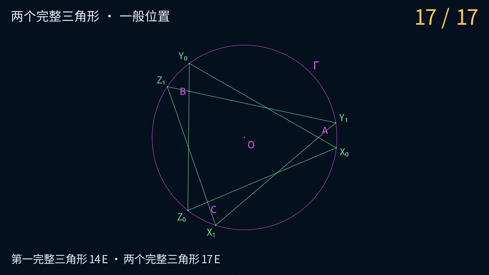

# Castillon 14 E 与 17 E 动画

两段视频各自从免费输入圆 Γ、圆心 O 和 A、B、C 开始。

| 场景 | 目标 | 成片 |
|---|---|---|
| `CastillonOne` | 一个完整三角形，14 条直线 | [4K60 MP4](media/CastillonOne_4k60.mp4) |
| `CastillonBoth` | 两个完整三角形，17 条直线 | [4K60 MP4](media/CastillonBoth_4k60.mp4) |



## 几何与视觉

采用已提交证书的 `inside` 夹具，单位圆的圆心为 `(0,0)`，
三个输入点为 `A=(4/5,0)`、`B=(-3/5,1/2)`、`C=(-2/5,-7/10)`。
导出器先重建精确程序，逐项核对证书中的输入、动作与分数，再转换显示坐标。
导出数据保留父对象、精确交点坐标、交点分支、可用时刻与程序哈希。

风格参考 [Euclid-CCC-Min](https://github.com/lenovobenben/euclid-ccc-min)。
深蓝背景、中文字幕和细线保持一致。洋红色表示免费输入，金色表示当前一笔，
淡蓝色表示辅助对象，绿色表示目标。每笔先标出两个已有定位点，再画出完整直线。
第 11 E 放大 J、H 附近，画轴后回到全景，展示两个免费圆交点。
镜头运动时补偿线宽、点大小和文字大小。

三角形完成时，绿色线段覆盖在已经画出的边所在直线上，作为显示高亮。
视频中的数学判断来自精确证书及独立 Sage 验证，显示坐标使用浮点近似。
构造的一般位置范围见 [CONSTRUCTION](../../docs/CONSTRUCTION.md)。

## 步骤与里程碑

| E | 内容 |
|---:|---|
| 1–7 | 复用投影链，取得三组对应点对 |
| 8–10 | 构造不动点轴上的 J、H |
| 11 | 画轴，得到 X₀、X₁ |
| 12–13 | 得到第一解的全部顶点 |
| 14 | 补齐第一解第三条边 |
| 15–16 | 得到第二解的其余顶点 |
| 17 | 补齐第二解第三条边 |

独立的全部顶点程序为 15 E。17 E 视频中，全部顶点在第 16 E 出现，
因为第 14 E 已经画出第一个完整三角形的第三条边。

## 导出、测试与渲染

在仓库根目录运行，仅需 Python 3.10+ 标准库。

```sh
python3 animations/castillon/export_geometry.py
python3 -m unittest discover -v
```

安装 Manim 后会同时运行镜头与直线裁剪测试。Docker 环境沿用 CCC 的
Manim 0.21.0 和 Noto Sans CJK SC 字体，可使用已有的 `euclid-min-manim:0.21.0` 镜像。
本目录也提供基于同一固定上游镜像的 Dockerfile。

```sh
docker build -t euclid-min-manim:0.21.0 animations/castillon
docker run --rm --network none -v "$PWD:/manim" -w /manim \
  euclid-min-manim:0.21.0 python -m unittest discover -v
```

720p30 预览与 4K60 母片分别使用以下命令。

```sh
docker run --rm --network none -v "$PWD:/manim" -w /manim \
  euclid-min-manim:0.21.0 \
  manim --config_file animations/castillon/manim.cfg -r 1280,720 --fps 30 \
  animations/castillon/castillon_progress.py CastillonOne CastillonBoth

docker run --rm --network none -v "$PWD:/manim" -w /manim \
  euclid-min-manim:0.21.0 \
  manim --config_file animations/castillon/manim.cfg --fps 60 \
  animations/castillon/castillon_progress.py CastillonOne CastillonBoth
```

Windows PowerShell 可将 Docker 命令写成单行，并将挂载参数改为
`-v "${PWD}:/manim"`。本机 Python 命令可使用 `py -3.12`。

母片位于 `media/videos/castillon_progress/2160p60/`。
播放版经 FFmpeg 转为恒定 60 fps，并把 MP4 索引移至文件开头。
以下示例生成单解播放版，双解时将文件名替换为 `CastillonBoth`。

```sh
ffmpeg -n -i animations/castillon/media/videos/castillon_progress/2160p60/CastillonOne.mp4 \
  -vf fps=60 -c:v libx264 -preset fast -crf 18 -maxrate 24M -bufsize 48M \
  -g 120 -keyint_min 120 -sc_threshold 0 -bf 2 -refs 2 \
  -pix_fmt yuv420p -fps_mode cfr -movflags +faststart -an \
  animations/castillon/media/CastillonOne_4k60.mp4
```

代码、测试与配置采用 [Apache 2.0](../../LICENSE)。文档、几何数据及动画成品
采用 [CC BY 4.0](../../LICENSE-CONTENT)。
